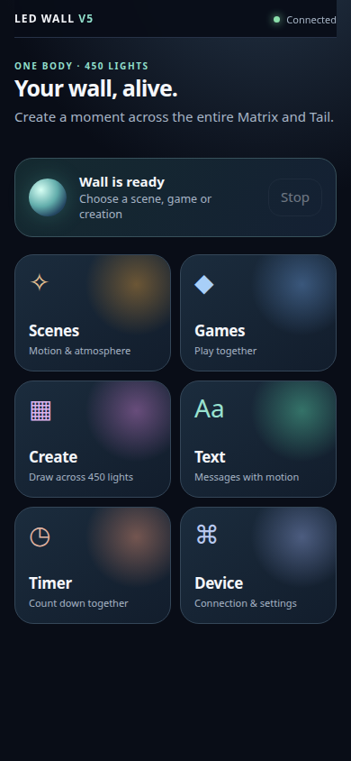
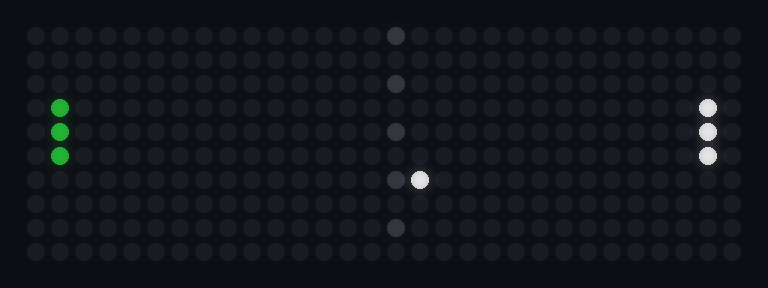
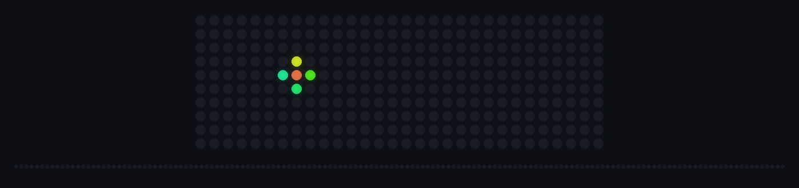

# LED Wall

[](https://github.com/IamRedi/led-wall-showcase/actions/workflows/ci.yml)

**Eine LED-Wand als eigenständiges Gerät.** Ein ESP32 steuert eine Matrix aus 30 × 10 WS2812-LEDs und eine zweite, frei verlegte LED-Leiste („Tail“, 150 Zellen). Darauf laufen Text, Szenen, Animationen, Gesichtsausdrücke, ein Countdown und 14 Spiele für ein oder zwei Spieler. Gesteuert wird sie über eine Web-Oberfläche, die das Gerät selbst ausliefert, über einen DualShock-4-Controller oder von außen über eine klar begrenzte API.

LED Wall ist das zweite Gerät der HUGO-Familie: [HUGO](https://github.com/IamRedi/hugo-core-showcase), der KI-Assistent des Autors, kann die Wand als „Gesicht“ und Anzeige benutzen, ohne je eine einzelne LED anzufassen. Was davon bewiesen ist, steht unten im Abschnitt [Rolle im HUGO-Ökosystem](#rolle-im-hugo-ökosystem).

[English version](README.en.md) · [Projektstand](docs/PROJEKTSTAND.md) · [Prüfprotokoll](EVIDENCE.md) · [Sicherheit](SECURITY.md) · [API-Vertrag](docs/api/CONTRACT.md)

| Oberfläche vom Gerät (Handy) | Pong, Bild aus dem echten Renderer | Feuerwerk über Matrix und Tail |
|---|---|---|
|  |  |  |

Das Handy-Bild ist ein Screenshot der Oberfläche, die das echte Gerät ausgeliefert hat. Die LED-Bilder sind exakte Frames aus dem Firmware-Code (`tests/capture_v41_frames.sh`, als LEDs gezeichnet mit `tools/render_frames.py`), keine Fotos der Wand.

> **Nachweisstand und Grenzen:** Die veröffentlichte Fassung wurde mit Host-Tests ohne angeschlossenen ESP32 oder LEDs geprüft. Der Betrieb der physischen LED-Wand beruht auf Angaben des Autors; eine formale elektrische Messprüfung steht noch aus. [Prüfprotokoll](EVIDENCE.md).

## Auf einen Blick

| | |
|---|---|
| **Was** | Firmware und Bedienung für eine LED-Wand: Text, 45 Szenen/Animationen, 12 Ausdrücke, 14 Spiele, Countdown/Timer, Pixel-Editor, Benachrichtigungen, Standby |
| **Hardware** | ESP32 (4 MB Flash), 300 WS2812 an GPIO13 (10 Streifen à 30, Schlangenlinie), Tail-Leiste an GPIO27, separates LED-Netzteil, optional DualShock 4 über Bluetooth |
| **Technik** | C++17 auf Arduino/PlatformIO (FastLED, WebSockets, ArduinoJson; DS4 über Bluepad32), Web-Oberfläche ohne Build-Schritt im Flash, Python 3 nur mit Standardbibliothek für die Adapter |
| **Schnittstellen** | Lokale HTTP/WebSocket-API, Home-Assistant-Adapter (MQTT), HUGO-Adapter (JSON-RPC über stdio) |
| **Tests** | 44.552 C++-Prüfungen, 79 JavaScript-Prüfungen, 269 Python-Tests, alle grün ([Prüfprotokoll](EVIDENCE.md)) |
| **Status** | Läuft beim Autor als echtes Gerät und funktioniert laut Besitzer (27.10.2026) zuverlässig. Kein kommerzielles Produkt; eine formale elektrische Messung steht aus ([Projektstand](docs/PROJEKTSTAND.md)) |

## Was es kann

- **Ein Gerät, zwei Anzeigeflächen.** Die Matrix (30 × 10) und die Tail-Leiste werden gemeinsam oder getrennt bespielt. Effekte wie Feuerwerk, Meteor-Einschlag oder Gewitter laufen über beide Flächen.
- **Spiele.** Pong, Snake, Breakout, Reaktion, Dodger, Farbkette, Lichtrennen, Reaktions-Stopp, Farbfangen, Memory, Tauziehen, Tail-Tennis, Light Quest, Quick Draw. Zwei Spieler über Handy und DualShock-4-Controller, mit Spieler-Sitzungen, Heartbeat und Pause bei Verbindungsverlust.
- **Text und Zeit.** Laufschrift in einer 5 × 7-Schrift, Text-Studio, Countdown und Timer direkt auf dem Gerät.
- **Eine Hoheit.** Das Gerät allein entscheidet, was angezeigt wird: genau ein Grundmodus, höchstens eine kurzzeitige Einblendung, keine Warteschlange. `clear` macht immer alles dunkel. Die Helligkeit hat eine feste Obergrenze, die kein Client überschreiten kann.
- **Bedienung ohne App.** Die Web-Oberfläche (sechs Bereiche: Szenen, Spiele, Malen, Text, Timer, Gerät) liegt komprimiert im Flash und läuft auf jedem Handy im WLAN.
- **Andere Systeme sind nur Clients.** Home Assistant und HUGO sprechen dieselbe semantische API wie das Handy. Die Wand funktioniert ohne sie.

```
Handy-Oberfläche ─┐
Home Assistant ───┤                      ┌─ Matrix 30×10 (GPIO13)
HUGO (Adapter) ───┼─▶ semantische API ─▶ ESP32-Laufzeit ─▶ Renderer ─┤
DualShock 4 ──────┘                      └─ Tail-Leiste (GPIO27)
```

## Rolle im HUGO-Ökosystem

HUGO ist der persönliche KI-Assistent des Autors. [HUGO Core](https://github.com/IamRedi/hugo-core-showcase) hält Identität, Gedächtnis und Berechtigungen; Geräte wie LED Wall, [HUGO Eye](https://github.com/IamRedi/hugo-eye-showcase) oder ein ESP32-Roboter bleiben eigenständig. Die Regel: **die KI äußert eine Absicht, das Gerät rendert deterministisch.**

**Was im Code steht und getestet ist:**

- `hugo_adapter/` ist ein eigenständiger Adapter (Python, nur Standardbibliothek), der die Wand als feste Werkzeugliste anbietet: `show_text`, `clear_text`, `set_scene`, `set_animation`, `set_expression`, `set_brightness`, `clear_display`, `get_state`, `get_device_info`. Transport: JSON-RPC 2.0 über stdin/stdout ([hugo_adapter/README.md](hugo_adapter/README.md)).
- Der Ausdrucks-Wortschatz ist für einen Assistenten gemacht: `idle`, `listening`, `thinking`, `speaking`, `happy`, `alert`, `error`, `sleeping` (dazu `bored`, `tired`, `focused`, `excited`). HUGO kann so auf der Wand zeigen, ob es zuhört, nachdenkt oder spricht.
- HUGO sieht nie LED-Indizes, GPIO, FastLED oder Renderer-Funktionen. Argumente werden vor jedem Gerätezugriff geprüft und bei Fehlern abgelehnt; Werkzeuge, die das Gerät nicht anbietet, verschwinden statt zu raten. Entdecken heißt nicht steuern dürfen.
- 158 Tests für den HUGO-Adapter gegen ein nachgebautes Gerät (Konfiguration, Gerätezugriff, Absichten, JSON-RPC, Integration). Die Firmware enthält null HUGO-Code.

**Was noch nicht bewiesen ist:** Der Adapter lief noch nie gegen ein laufendes HUGO Core und noch nie gegen die echte Wand; geprüft ist er mit einem nachgebauten Gerät. Außerdem spricht er sein eigenes JSON-RPC-Format; die Anbindung an den Fähigkeiten-Vertrag von HUGO Core (wie ihn [HUGO Eye](https://github.com/IamRedi/hugo-eye-showcase) bereits umsetzt) ist ein eigener, offener Schritt.

## Ausprobieren ohne Hardware

Voraussetzungen: g++ (C++17), Python 3.10+, Node.js 20+.

```bash
git clone https://github.com/IamRedi/led-wall-showcase && cd led-wall-showcase
bash tests/run_tests.sh                       # alle Host-Tests: C++, JavaScript, Python

# Frames aus den echten Renderern erzeugen und als LED-Bild zeichnen (Pillow nötig)
bash tests/capture_v41_frames.sh /tmp/frames
python3 tools/render_frames.py /tmp/frames /tmp/frames-png
```

Die Spiel- und Effektlogik ist so geschnitten, dass sie ohne ESP32 auf dem PC läuft; nur Treiber für LEDs, WLAN und Speicher sind gerätespezifisch.

## Firmware bauen

```bash
pip install platformio
pio run -e esp32_eq -d firmware               # Standard-Firmware
pio run -e esp32_eq_ds4 -d firmware           # mit DualShock 4 (Bluepad32)
```

Die WLAN-Zugangsdaten stehen nicht im Quellcode, sondern im NVS-Speicher des Geräts; die Firmware gibt sie nie über die API heraus. `tools/nvs_provision.py` bearbeitet nur Hardware-Einstellungen (z. B. Tail-Länge) in einem NVS-Abbild, nie direkt auf dem Gerät.

## Aufbau

```
firmware/src/
  core/       Laufzeit, Modusmaschine, Helligkeit mit Obergrenze, Konfiguration
  api/        HTTP- und WebSocket-Server, Befehle, Register, Zustand, eingebettete Oberfläche
  render/     LED-Treiber, Matrix/Tail-Topologie, Bildrate, Strom-Schätzung und Ausgangsbegrenzung
  effects/    Animationen, Tail-Effekte, Ausdrücke
  games/      14 Spiele, Spiel-Host
  input/      Tasten, DualShock 4, Spieler-Sitzungen
  text/ timer/ menu/ pixel/ scene/ sound/ visualizer/
firmware/web/ Quellen der Oberfläche V5
ha_adapter/   Home-Assistant-Adapter (MQTT ↔ HTTP)
hugo_adapter/ HUGO-Adapter (JSON-RPC über stdio)
tests/        Host-Tests für Firmware-Logik, Oberfläche und Adapter
docs/         API-Vertrag, Entscheidungen (ADR), Basis-Spezifikation, Prüfkatalog
```

## Lizenz

Quellcode zum Lesen und Bewerten, nicht zur Weiterverwendung: siehe [LICENSE](LICENSE). Bibliotheken wie FastLED, WebSockets, ArduinoJson und Bluepad32 holt PlatformIO beim Bauen; sie stehen unter ihren eigenen Lizenzen.
